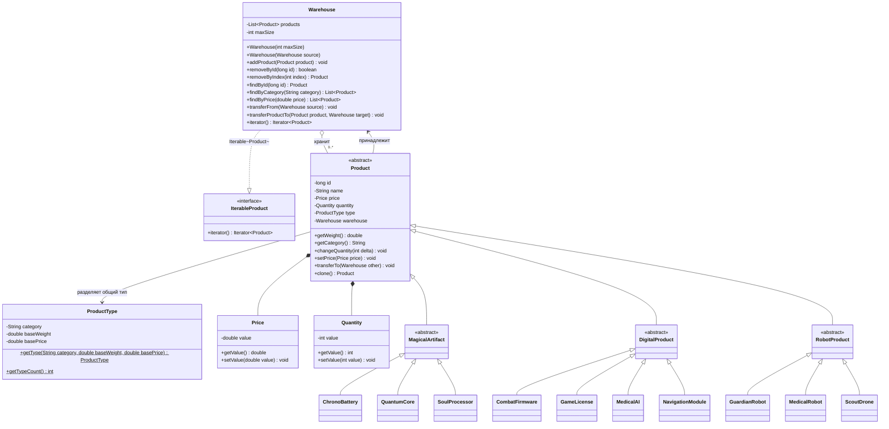
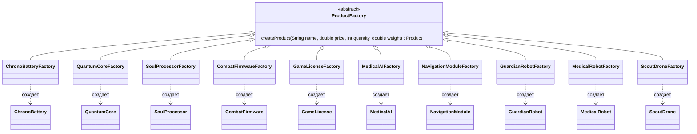
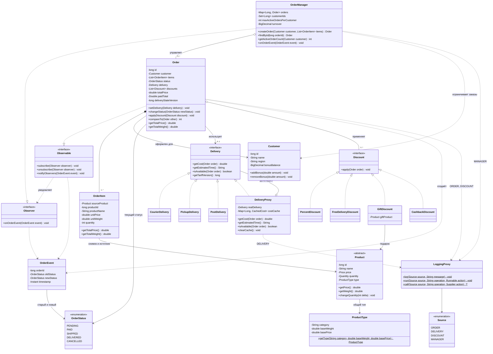

# Практические работы по ООП на Java

«Магазин и склад» — учебный проект на Java 17. В трёх работах он развивается от склада и фабрик товаров до оформления заказов, доставки и единого интерфейса управления. Приложение можно запустить в Swing или в терминале.

[Сборка, запуск и проверки](#запуск) · [Сценарии для защиты](docs/practical-work-3-summary.md#демонстрация)

## Навигация

- [Лабораторная 1 — склад](#лабораторная-1--склад)
  - [Возможности](#возможности-лабораторной-1)
  - [Архитектура склада](#архитектура-склада)
  - [Фабрики продуктов](#фабрики-продуктов)
- [Лабораторная 2 — заказы и доставка](#лабораторная-2--заказы-и-доставка)
  - [Возможности](#возможности-лабораторной-2)
  - [Архитектура заказов](#архитектура-заказов)
- [Лабораторная 3 — интеграция магазина](#лабораторная-3--интеграция-магазина)
- [Использованные паттерны](#использованные-паттерны)
- [Аналоги конструкций C++ в Java](#аналоги-конструкций-c-в-java)
- [Отчёты по работам](#отчёты-по-работам)
- [Структура проекта](#структура-проекта)
- [Запуск](#запуск)
- [Проверка сообщений коммитов](#проверка-сообщений-коммитов)

---

## Лабораторная 1 — склад

[К оглавлению](#навигация) · [Отчёт №1](docs/practical-work-1-summary.md)

Первая лабораторная описывает склад и иерархию товаров: магические артефакты, цифровые продукты и роботов.

### Возможности лабораторной 1

- склад с ограниченной вместимостью;
- добавление, удаление, поиск и перенос товаров между складами;
- обход товаров через стандартный `Iterator<Product>`;
- создание конкретных продуктов через фабрики;
- глубокое копирование склада с клонированием товаров;
- разделение изменяемых данных товара и общего типа `ProductType` (добавлено в работе №2);
- готовый склад `demo` с 75 разнообразными товарами при пустом стартовом `main`.

### Архитектура склада



`Product` хранит собственные `Price` и `Quantity`, а категория, базовый вес и базовая цена вынесены в неизменяемый `ProductType`. Одинаковые наборы этих значений получают общий экземпляр типа из внутреннего кэша. Метод `getWeight()` читает `baseWeight`, а `getCategory()` — категорию из `ProductType`; отдельных полей `Weight` и `category` в `Product` нет.

`Warehouse` реализует `Iterable<Product>` и возвращает итератор внутреннего `ArrayList`, поэтому склад можно обходить стандартным циклом `for-each`.

### Фабрики продуктов



Каждая конкретная фабрика создаёт свой подкласс `Product` и хранит его специфическую конфигурацию. Общие параметры товарной позиции передаются в `createProduct(...)`.

---

## Лабораторная 2 — заказы и доставка

[К оглавлению](#навигация) · [Отчёт №2](docs/practical-work-2-summary.md)

Вторая лабораторная добавляет покупателей, заказы, варианты доставки, скидки и обработку событий изменения статуса заказа.

### Возможности лабораторной 2

- создание заказа из снимков товарных позиций `OrderItem`;
- проверка и списание остатков при создании заказа;
- ограничение количества активных заказов покупателя;
- допустимые переходы между статусами `PENDING`, `PAID`, `SHIPPED`, `DELIVERED` и `CANCELLED`;
- выбор доставки с проверкой доступности и расчётом стоимости;
- процентная скидка, бесплатная доставка, подарок и начисление кешбэка;
- учёт оборота при оплате и возврат товаров на склад при отмене заказа;
- уведомление подписчиков через события `OrderEvent`;
- единое логирование операций с источниками `ORDER`, `DELIVERY`, `DISCOUNT`, `MANAGER`;
- отдельная Swing-вкладка для покупателей, заказов, доставок, скидок и статусов.

### Архитектура заказов



`OrderManager` подписывается на созданные заказы. Оплата увеличивает оборот на зафиксированную сумму, а отмена возвращает товар и, если заказ был оплачен, вычитает эту сумму из оборота. `OrderItem` хранит снимок цены, веса и названия, а ссылка на исходный `Product` нужна для работы с остатком.

`DeliveryProxy` оборачивает стратегию доставки и проверяет доступность. У курьера и почты есть ограничения по весу; у самовывоза такого лимита нет. Кэш стоимости учитывает ID заказа, версию его состояния и версию тарифа.

---

## Лабораторная 3 — интеграция магазина

[К оглавлению](#навигация) · [Отчёт №3](docs/practical-work-3-summary.md)

В Swing сохранены вкладки **«Склад»** и **«Заказы»**. Новая вкладка **«Команды»** работает с теми же складами, покупателями и заказами: начните с `help`. При необходимости тот же набор команд можно запустить без GUI (`java -cp out Main --cli`).

- **Facade:** `ShopFacade` — один прикладной вход для операций и просмотра данных, делегирует предметным классам.
- **Mediator:** `OrderMediator` связывает склад, `OrderManager`, заказ, доставку и акции. Создание, учебная оплата и отправка — разные действия.
- **Command:** `ShopCommand<R>` хранит действие и параметры в лямбде; Swing и парсер используют `ShopFacade.execute(...)`.
- **Chain of Responsibility:** товарный, заказной и информационный обработчики распознают свою группу команд или передают ввод дальше. Неизвестное действие отличается от ошибки аргументов.

### Быстрая проверка

В свежем запуске склад `main` пуст, в `demo` уже есть 75 товаров. На вкладке **«Команды»** или в терминале:

```text
product add main ScoutDrone "Учебный дрон" 100.00 3 2
show products main
show customers
```

Подставьте ID из вывода в `order create main <id-покупателя> courier percent <id-товара>:2`. Заказ останется `PENDING` с итогом `680.00 USD`. Дальше выполните `order pay <id-заказа>`, `order ship <id-заказа>` и `show statistics`.

### Контракт

| Что | Правило |
|---|---|
| Деньги | USD, ввод в долларах с десятичной точкой. `Price` сохраняет прежний API с `double`, конечные суммы округляются до цента (`HALF_UP`); процентные вычисления и накопление оборота используют `BigDecimal`. Тарифы `500` и `200` — доллары, не центы. |
| Масса и количество | Масса в кг на единицу; масса строки — масса единицы × количество. Изменение доступного остатка принимает целую знаковую дельту; остаток не бывает отрицательным. |
| Склад | При создании списываются все строки после проверки их суммарного количества и выбранных настроек заказа. До отправки отмена возвращает списанное один раз. Нельзя удалять или переносить товар активного заказа (`PENDING`, `PAID`, `SHIPPED`). |
| Заказ | Цена единицы фиксируется при добавлении строки, итог и стоимость доставки — при оплате. В Swing можно создать черновик, добавить строки и затем выбрать доставку и акцию. Текстовая команда создания принимает их сразу. |
| Отправка и ошибки | Перед отправкой повторно проверяется доступность через `DeliveryProxy`. Кэш зависит от состояния заказа и версии тарифа стратегии. Отказ не меняет статус и остаток. |
| Оплата и статистика | Учебная оплата без внешнего сервиса. Оборот — сумма успешных оплат за вычетом оплаченных отмен. Кешбэк начисляется при оплате и снимается при возврате. Подарок не является оплачиваемой складской строкой. Заказы в статистике включают отменённые; покупатели — те, у кого был зарегистрирован заказ. |

Схема зависимостей, таблица адаптаций и три сценария для показа — в [отчёте №3](docs/practical-work-3-summary.md).

---

## Использованные паттерны

| Паттерн | Реализация в проекте |
|---|---|
| **Iterator** | `Warehouse` реализует `Iterable<Product>` и предоставляет стандартный итератор коллекции товаров. |
| **Factory Method** | Абстрактный `ProductFactory` задаёт метод создания, а конкретные фабрики возвращают соответствующие виды продуктов. |
| **Prototype** | Каждый конкретный `Product` реализует `clone()`, а копирующий конструктор `Warehouse` создаёт глубокую копию товаров. |
| **Flyweight** | `ProductType` хранит общие неизменяемые данные типа и переиспользует экземпляры с одинаковыми категорией, базовым весом и базовой ценой. |
| **Strategy** | Реализации `Delivery` взаимозаменяемо определяют стоимость и доступность доставки; реализации `Discount` инкапсулируют разные способы применения скидки. |
| **Proxy** | `DeliveryProxy` реализует тот же интерфейс, делегирует реальной доставке и добавляет проверки и версионный кэш стоимости с автоматической инвалидацией. `LoggingProxy` централизует журналирование операций разных подсистем. |
| **Observer** | `Order` выступает как `Observable`, создаёт `OrderEvent` при смене статуса и уведомляет `Observer`; `OrderManager` реагирует на событие. |

---

## Аналоги конструкций C++ в Java

Задание сформулировано с примерами на C++, поэтому операции адаптированы к возможностям Java:

| Конструкция из задания | Java-эквивалент в проекте |
|---|---|
| `order + discount` | `order.applyDiscount(discount)` |
| `delivery << order` | `order.assignTo(delivery)` |
| `order1 < order2` | `order1.compareTo(order2) < 0` |
| `ostream << order` | переопределённый `order.toString()` |
| `shared_ptr<T>` | обычная ссылка на объект; временем жизни управляет сборщик мусора |
| `const T&` | ссылка без копирования и неизменяемые представления через `Collections.unmodifiableList(...)` |
| чисто виртуальный метод | метод интерфейса или `abstract`-метод |
| деструктор | автоматическая сборка мусора; для внешних ресурсов применяется `AutoCloseable` |

Java не поддерживает пользовательскую перегрузку операторов, поэтому именованные методы делают те же операции явно и читаемо.

## Отчёты по работам

- [Практическая работа №1 — склад](docs/practical-work-1-summary.md)
- [Практическая работа №2 — заказы, доставка и паттерны](docs/practical-work-2-summary.md)
- [Практическая работа №3 — интеграция и команды](docs/practical-work-3-summary.md)

---

## Структура проекта

```text
oop/
├── .githooks/
│   └── commit-msg          # проверка формата сообщений коммитов
├── docs/                   # дополнительная документация
├── src/
│   ├── command/            # разбор текстового ввода и цепочка обработчиков
│   ├── customer/           # покупатели
│   ├── demo/               # генератор демонстрационного склада
│   ├── delivery/           # стратегии доставки и прокси
│   ├── discount/           # стратегии скидок
│   ├── factory/            # фабрики продуктов
│   ├── inventory/          # склад
│   ├── logging/            # централизованное логирование операций
│   ├── observer/           # наблюдатели и события заказов
│   ├── order/              # заказы и управление ими
│   ├── product/            # товары, типы и атрибуты
│   ├── shop/               # фасад и контракт команды
│   ├── ui/                 # Swing-интерфейс
│   └── Main.java           # точка входа
├── out/                    # результат компиляции
├── tests/                  # проверки магазина и Swing
└── README.md
```

## Запуск

Нужен JDK 17 или новее. Из корня проекта в PowerShell:

```powershell
New-Item -ItemType Directory -Force out | Out-Null
$sources = Get-ChildItem -Path src, tests -Recurse -Filter '*.java' | ForEach-Object FullName
javac --release 17 -encoding UTF-8 -d out $sources
java -cp out Main
```

Из Git Bash или другого `sh`:

```sh
mkdir -p out
find src tests -name '*.java' > out/sources.txt
javac --release 17 -encoding UTF-8 -d out @out/sources.txt
java -cp out Main
```

- `java -cp out Main --cli` — интерактивные команды; `help` показывает синтаксис, `exit` завершает сеанс.
- `java -cp out Lab3Checks` — склад, парсер, акции, жизненный цикл заказа, отказы и кэш доставки.
- `java -cp out SwingChecks` — вкладка «Команды» и обновление таблиц склада и заказов (нужна графическая среда).

## Проверка сообщений коммитов

Проект использует хук `.githooks/commit-msg`, проверяющий сообщения в формате [Conventional Commits](https://www.conventionalcommits.org/):

```text
<type>(optional-scope): <description>
```

Допустимые типы: `feat`, `fix`, `docs`, `style`, `refactor`, `perf`, `test`, `build`, `ci`, `chore`, `revert`.

Примеры:

```text
feat: add warehouse search
fix(ui): validate product price
refactor(factory)!: change product factory API
```

После клонирования репозитория включите хук один раз:

```bash
git config core.hooksPath .githooks
```

Заголовок коммита ограничен 72 символами. Merge-, revert-, fixup- и squash-коммиты, созданные Git, разрешены автоматически.
