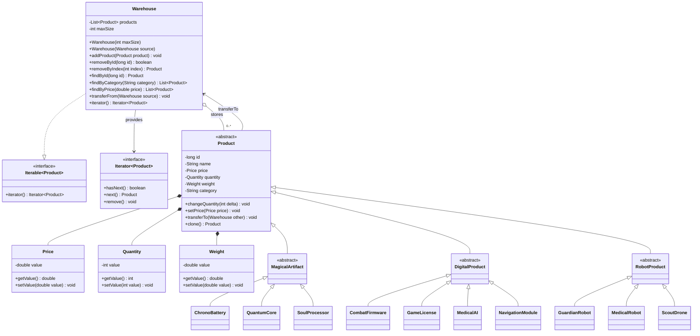
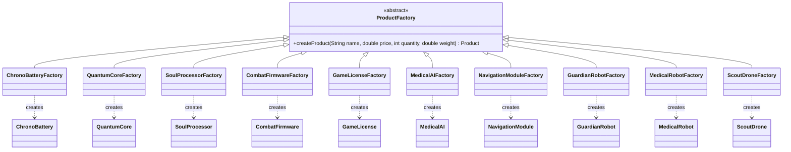

# IS-OOP-Practical-Works

Система управления складом и каталогом товаров на Java. Проект демонстрирует наследование, композицию, глубокое копирование, фабричный метод и обход склада через стандартный Java-итератор.

## Архитектура предметной области

`Warehouse` реализует `Iterable<Product>` и адаптирует стандартный итератор `ArrayList` через `products.iterator()`. В Java это эквивалент обхода от `begin()` до `end()` в C++.

## Фабричный метод

Каждая конкретная фабрика хранит специфическую конфигурацию продукта. Общие параметры товарной позиции (`name`, `price`, `quantity`, `weight`) передаются в `createProduct(...)`, после чего фабрика создаёт соответствующий конкретный `Product`.
