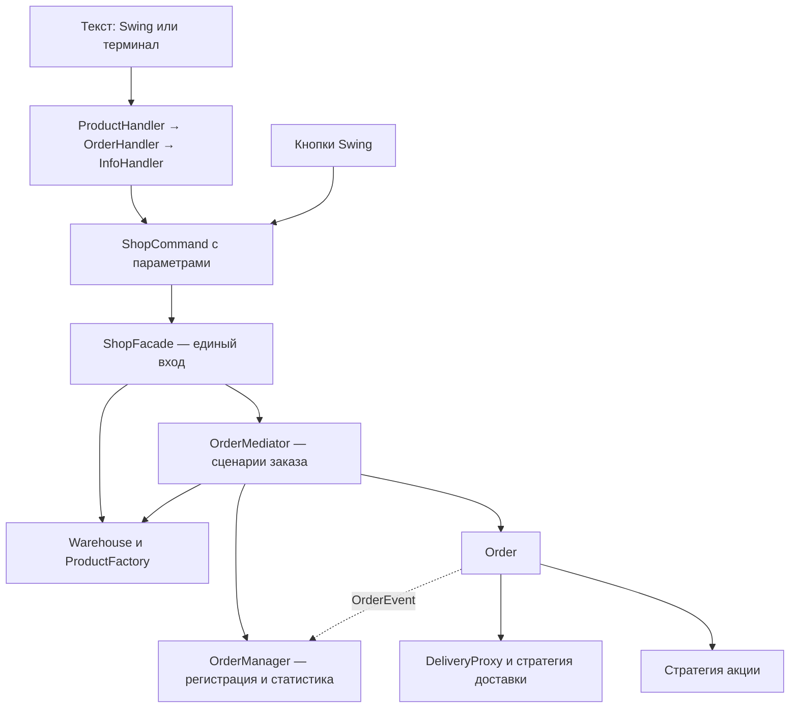

# Практическая работа №3 — логическое разделение классов

[← К README](../README.md) · [Работа №1](practical-work-1-summary.md) · [Работа №2](practical-work-2-summary.md) · **Работа №3**

Цель — связать склад из №1 и заказы из №2. В одном окне сохранились вкладки склада и заказов. Вкладка **«Команды»** меняет те же данные, что и кнопки. Отдельный запуск `Main --cli` открывает новый экземпляр магазина без Swing.

## Роли и зависимости



`ShopCommand<R>` — объект команды с аргументами, захваченными лямбдой. `ShopConsole` токенизирует ввод; каждый обработчик разбирает только свою группу, а остальное передаёт дальше. Выполняет команду `ShopFacade.execute(...)`. Для Swing текстовый разбор не нужен: формы сразу собирают типизированные команды. Парсер и Swing не выполняют расчёты и не меняют остатки сами.

История команд и общий `undo` не реализованы: это необязательные расширения. Команда `order cancel <id>` отменяет конкретный заказ только до отправки. Если заказ был оплачен, отмена учитывается как возврат, а не как откат последней команды.

## Было → адаптация → причина → сохранённый сценарий

| Было | Адаптация | Причина | Сохранённый сценарий |
|---|---|---|---|
| `Warehouse`, фабрики, `ProductType` и итератор | Фасад хранит именованные склады и делегирует операции старым классам | Одна и та же модель для кнопок и команд | Фабричное создание, обход, перенос, независимая копия с новыми ID товаров |
| `OrderItem` и списание при создании | `OrderMediator` проверяет все строки, доставку и акцию до регистрации; `OrderManager` суммирует количество по товару | Ошибка второй строки или акции не оставляет частичного заказа | Снимок цены, добавление/удаление строк черновика, списание и возврат |
| `Observer` и статистика | При оплате фиксируется сумма, при оплаченной отмене оборот уменьшается на неё | Повторное действие не меняет учёт; возврат не зависит от текущей цены | События статусов, оборот и лимит активных заказов |
| `DeliveryProxy` и стратегии акций/доставки | Проверка доступности перед отправкой; версия тарифа добавлена в ключ кэша | Изменившийся тариф не берётся из старого кэша, а отказ не меняет статус | Прежние скидки, доставка, проверка веса и повторное чтение стоимости из кэша |
| Swing | Две старые вкладки переведены на фасад; добавлена третья | Один код операций, разные способы ввода | Формы создания товаров, редактирование заказа, доставка, акции и смена статуса |

## Демонстрация

Откройте вкладку **«Команды»** или запустите `java -cp out Main --cli`. Команда `help` показывает синтаксис. В свежем запуске `main` пуст, `demo` содержит 75 товаров. ID ниже — примеры для последовательного выполнения в свежем приложении; сверяйте их по `show products main`, `show customers` и ответам на создание заказов.

### 1. Склад, фабрики и копирование

```text
product add main ScoutDrone "Учебный дрон" 100.00 3 2
warehouse copy main backup
product price main 76 110.00
product stock main 76 -1
show products main
show products backup
product add main GameLicense "Учебная лицензия" 20.00 1 0.1
product move main backup 78
product remove backup 78
product price main 76 100.00
product stock main 76 +1
```

Копия сохраняет исходные цену и количество, но получает другой ID. Перенос сохраняет ID позиции. В конце у дрона `#76` снова цена `100.00 USD` и остаток `3`.

### 2. Заказ, оплата и отправка

```text
order create main 1 courier percent 76:2
order create main 1 pickup none 76:2
product remove main 76
product price main 76 120.00
order pay 1
order pay 1
show orders 1
show statistics
order ship 1
order deliver 1
```

Первый заказ `PENDING`: два товара со скидкой 10% и курьер — `680.00 USD`. Второму заказу не хватает остатка, удалить позицию активного заказа нельзя. Цена в каталоге меняется, но сумма заказа остаётся `680.00 USD`. Повторная оплата отклоняется, оборот не удваивается, отправка не списывает товар заново.

### 3. Отказы, возврат и проверка доставки

```text
product add main ScoutDrone "Тяжёлый дрон" 50.00 1 25
order create main 1 pickup none 76:1 79:2
order create main 1 courier none 79:1
show products main
order create main 1 pickup cashback 76:1
show orders
```

При нехватке второй строки дрон `#76` остаётся на складе, а курьер не принимает товар весом 25 кг. Успешный заказ с кешбэком оплатите, затем отмените через `order pay <id>` и `order cancel <id>` (используйте выданный ID). Повторите отмену: остаток, оборот и бонусный баланс не меняются второй раз. Для ошибок ввода попробуйте `unknown` (`Unknown command`), `order ship abc` (`Invalid arguments`) и `order ship 999999` (`Order not found`).

`Lab3Checks` дополнительно меняет доступность тестовой стратегии уже **после оплаты**: `ship` отклоняется, заказ остаётся `PAID`, запас не меняется. Тот же сценарий проверяет повторное использование и инвалидацию тарифа. `SwingChecks` выполняет команды в поле ввода и сверяет обе таблицы. Инструкции запуска — в [README](../README.md#запуск).
